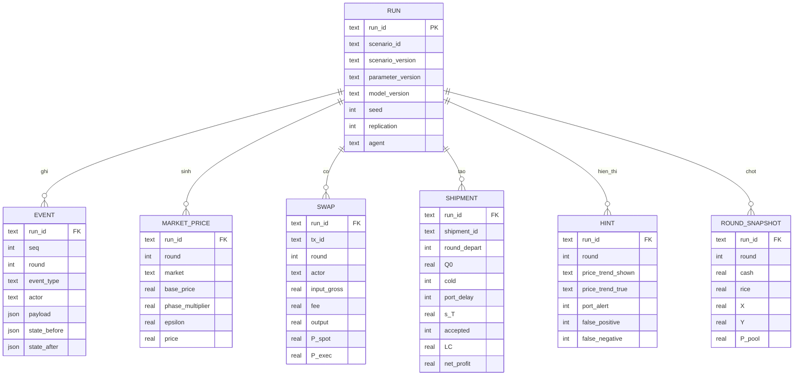

# ERD v0.1 (DRAFT) – chờ khóa cùng task "ERD" và GAME04

Nguồn trường: đặc tả 04/11 mục 9.1 (event log), GAME02 mục 2.3.6. Bảng SQL thật: `src/agrisim/storage/schema.sql`.

Việc cần chốt: kiểu dữ liệu và đơn vị từng trường (data dictionary), khóa ngoại hint → action kế tiếp (hint_id), bảng `local_sale` riêng hay để trong `event`.
